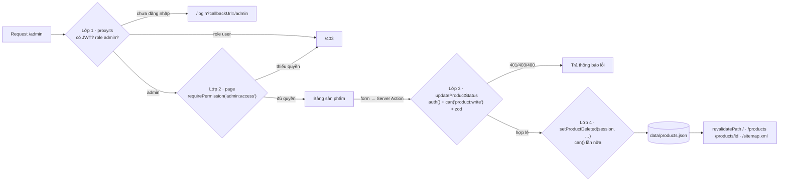

# Báo cáo Bài tập Buổi 8 — Next.js nâng cao: Xác thực, Phân quyền, SEO

Sinh viên: B23DCCC054 · Dự án: `LTWNC_Buoi8` (B8 Sport Shop) · Ngày đo: 20/10/2026

## 1. Đối chiếu yêu cầu

| Yêu cầu | Cách làm | Bằng chứng |
| --- | --- | --- |
| NextAuth, ít nhất 1 OAuth provider + email/mật khẩu | Auth.js v5 (`next-auth@5.0.0-beta.32`). Có **GitHub** OAuth và **Credentials**: dữ liệu vào kiểm tra bằng zod, mật khẩu băm bcrypt, có chống dò mật khẩu. Phiên lưu bằng JWT trong cookie httpOnly | [src/auth.ts](src/auth.ts), [src/auth.config.ts](src/auth.config.ts); e2e mục 2–3, 13–14 |
| Phân quyền 2 vai trò bằng Middleware + page + Server Action | `proxy.ts` (tên mới của middleware ở Next 16) → `requirePermission()` trong page → `updateProductStatus` kiểm tra quyền và zod → tầng dữ liệu kiểm tra lại. Ma trận quyền chỉ có một nguồn là `can()` | [src/proxy.ts](src/proxy.ts), [src/lib/guards.ts](src/lib/guards.ts), [src/app/(private)/admin/actions.ts](src/app/(private)/admin/actions.ts), [src/lib/products.ts](src/lib/products.ts) |
| Kiểu TypeScript đầy đủ cho Session | Mở rộng module `next-auth` (`User`, `Session`) và `@auth/core/jwt` (`JWT`), dùng `role: 'admin' \| 'user'`. Không dùng `any` | [src/types/next-auth.d.ts](src/types/next-auth.d.ts); `tsc --noEmit` không lỗi |
| SEO cho ≥ 2 trang công khai: canonical, opengraph-image, JSON-LD | Làm cho 3 trang `/`, `/products`, `/products/[id]` (16 sản phẩm). Mỗi trang có canonical, `opengraph-image.tsx` riêng và JSON-LD (Organization + WebSite, ItemList + BreadcrumbList, Product + BreadcrumbList). Thêm sitemap.ts, robots.ts, `noindex` cho trang riêng tư | Mục 4 |
| Sơ đồ các lớp bảo vệ + Lighthouse trước/sau | Mục 3 và mục 5 | `reports/lighthouse/summary.json` |
| Không commit khoá bí mật | `.env.local` nằm trong `.gitignore`. Chỉ commit `.env.example` (để trống giá trị) | `git status` không có `.env.local` |

Chiến lược render (lấy từ bảng `next build`):

| Route | Ký hiệu build | Chiến lược | Lý do |
| --- | --- | --- | --- |
| `/`, `/about` | ○ Static | SSG | Ít thay đổi. Admin sửa dữ liệu thì gọi `revalidatePath('/')` |
| `/products` | ○ · Revalidate 1m | ISR 60 s | Danh mục đổi định kỳ và cần SEO |
| `/products/[id]` | ● SSG · 1m | SSG + ISR 60 s | `generateStaticParams` sinh sẵn 16 trang |
| `/search` | ƒ Dynamic | SSR | Kết quả phụ thuộc `?q=` của từng request |
| `/login`, `/dashboard`, `/admin` | ƒ Dynamic | SSR | Phụ thuộc phiên của người dùng |

Header của trang công khai lấy phiên bằng `useSession()` ở client. Nếu gọi `auth()` ở đây thì Next phải đọc cookie, và mọi trang SSG/ISR sẽ thành dynamic. Header của khu `(private)` thì là Server Component gọi `auth()` để in tên và vai trò.

## 2. Đăng nhập

- **Credentials**: form gọi Server Action `loginWithCredentials`, action này gọi `signIn('credentials')` ([login/actions.ts](src/app/(public)/login/actions.ts)). Trong `authorize()`, dữ liệu được kiểm tra bằng zod rồi so mật khẩu bằng `bcrypt.compare`. Nếu email không tồn tại, hàm vẫn so với một hash giả để thời gian phản hồi giống nhau, người ngoài không đoán được email nào có thật.
- **Chống dò mật khẩu**: sai 5 lần với cùng cặp *email + IP*, hoặc sai 20 lần từ cùng một IP, trong 10 phút thì bị khoá. Khi bị khoá, hàm ném `CredentialsSignin` có `code = 'rate_limited'` để giao diện hiện thông báo riêng.
- **GitHub OAuth**: hàm `profile()` gán vai trò theo biến `ADMIN_GITHUB_LOGINS`. Khi không có database adapter, Auth.js tự sinh UUID mới cho `user.id` ở mỗi lần đăng nhập. Vì vậy callback `jwt` dùng `github:<providerAccountId>` làm id để id không đổi giữa các lần đăng nhập. Đã chạy thử với một OAuth app thật và đăng nhập thành công.
- **`callbackUrl`**: được lọc qua `safeCallbackUrl()`. Hàm này phân tích chuỗi bằng `new URL` rồi so origin. Reviewer đã tái hiện được lỗi open redirect với chuỗi `"/\t/evil.example"`, vì trình duyệt bỏ ký tự tab nên chuỗi này thành `//evil.example`. Lỗi đã được sửa, có unit test và đã kiểm tra lại bằng curl (mục 6).

## 3. Sơ đồ các lớp bảo vệ



| Lớp | Câu hỏi nó trả lời | File | Nếu chỉ có lớp này |
| --- | --- | --- | --- |
| 1. Proxy | Có phiên không? Vào `/admin` có phải admin không? | `src/proxy.ts` (matcher `/dashboard/:path*`, `/admin/:path*`) | Matcher cấu hình sai hoặc proxy bị vượt qua thì lộ hết |
| 2. Page | Người này có quyền xem dữ liệu của trang không? | `src/lib/guards.ts` | Server Action vẫn gọi được trực tiếp, không cần qua trang |
| 3. Server Action | Có quyền ghi không? Dữ liệu gửi lên có hợp lệ không? | `src/app/(private)/admin/actions.ts` | Hàm dữ liệu dùng ở nơi khác thì không còn ai kiểm tra |
| 4. Tầng dữ liệu | Chỉ trả hoặc ghi dữ liệu mà phiên này được phép | `src/lib/products.ts`, `src/lib/orders.ts` (lọc theo `session.user.id`) | — |

Layout `(private)` **không** dùng làm lớp phân quyền, vì layout không render lại khi chuyển giữa các trang con. Nút "Gỡ" chỉ hiện với admin, nhưng việc ẩn nút chỉ giúp giao diện gọn hơn, không phải bảo mật. Trang `/dashboard` của user có một nút gọi thẳng Server Action xoá để chứng minh lớp 3 vẫn từ chối (e2e mục 4).

Ma trận quyền ([src/lib/permissions.ts](src/lib/permissions.ts)), dùng chung cho cả 4 lớp:

| Hành động | guest | user | admin |
| --- | :-: | :-: | :-: |
| `product:read` xem sản phẩm | ✓ | ✓ | ✓ |
| `cart:add`, `order:create`, `order:read-own`, `dashboard:view` | ✕ | ✓ | ✓ |
| `product:write`, `user:manage`, `admin:access` | ✕ | ✕ | ✓ |

## 4. SEO

| Trang | canonical | og:image | JSON-LD | Khác |
| --- | --- | --- | --- | --- |
| `/` | `/` (+ hreflang `vi-VN`) | `(public)/opengraph-image.tsx` | Organization, WebSite + SearchAction | `title.absolute` |
| `/products` | `/products` | `products/opengraph-image.tsx` (ISR 60 s) | ItemList, BreadcrumbList | |
| `/products/[id]` | `/products/<id>` | `[id]/opengraph-image.tsx`: tên, danh mục, giá | Product + Offer (VND, InStock/OutOfStock), BreadcrumbList | `generateMetadata` |
| `/about` | `/about` | kế thừa từ `(public)` | BreadcrumbList | |
| `/login`, `/search`, `/403`, `/dashboard`, `/admin` | — | — | — | `robots: noindex` |

Cấu hình chung ở root layout: `metadataBase`, `title.template = '%s | B8 Shop'`. Root layout **không** đặt canonical, vì nếu đặt thì trang con nào quên ghi đè sẽ có canonical trỏ về `/`. Trong quá trình làm, mình gặp và sửa 2 lỗi về metadata:

1. Next gộp metadata **nông**: trang con khai báo `openGraph` thì thay luôn cả object của layout, làm mất `og:site_name` và `og:locale`. Cách sửa là luôn trải `OG_BASE` vào object của trang con.
2. Cũng vì gộp nông, `/products` mất `og:image`. Đã thêm `products/opengraph-image.tsx` (reviewer phát hiện).

JSON-LD được escape ký tự `<` thành `<` trước khi nhúng ([src/components/json-ld.tsx](src/components/json-ld.tsx)). Ảnh OG dùng font Be Vietnam Pro (subset latin + vietnamese) nên hiện đúng dấu tiếng Việt. Font này không có glyph `₫`, nên trên ảnh ghi giá bằng chữ "đ".

Kiểm tra bằng view-source (`curl http://localhost:3000/products/88`) thấy HTML đã có sẵn:

```html
<title>Nike Air Jordan 1 Red And Black | B8 Shop</title>
<meta name="description" content="Nike Air Jordan 1 Red And Black (Nike) giá 3.750.000 ₫. …"/>
<link rel="canonical" href="http://localhost:3000/products/88"/>
<meta property="og:image" content="http://localhost:3000/products/88/opengraph-image-g8o1a3?…"/>
<script type="application/ld+json">{"@context":"https://schema.org","@type":"Product",…}</script>
```

## 5. Lighthouse trước / sau

### Cách đo

| Mục | Giá trị |
| --- | --- |
| Bản "trước" | `npm run build:before && npm run start:before` (cổng 3001). `SEO_MODE=before`: không có description, canonical, JSON-LD; ảnh dùng `` gốc; font hệ thống |
| Bản "sau" | `npm run build && npm start` (cổng 3000): đầy đủ metadata, JSON-LD, `next/image`, `next/font` |
| Công cụ | Lighthouse 13.5.0 CLI, Chrome headless, cấu hình mobile mặc định (giả lập mạng 4G chậm và CPU chậm 4×) |
| Trang | `/` và `/products/88` |
| Số lần | 3 lần cho mỗi trang và mỗi bản, chạy xen kẽ trước/sau; lấy **trung vị** |
| Script | `reports/scripts/lh-run.mjs`, `lh-summary.mjs` → `reports/lighthouse/*.report.json`, `summary.json` |

Giới hạn của bản "trước": `opengraph-image.tsx` là file theo quy ước nên vẫn luôn gắn `og:image`. Ngoài ra, cả hai bản đều import `next/font`, nên bản "trước" vẫn preload 6 file font dù không dùng. OG và JSON-LD **không** có trong cách chấm điểm SEO của Lighthouse; hai phần này được kiểm tra bằng view-source (mục 4) và Rich Results Test.

### Kết quả (trung vị 3 lần)

| Chỉ số | `/` trước | `/` sau | `/products/88` trước | `/products/88` sau |
| --- | --: | --: | --: | --: |
| **SEO** | 92 | **100** | 92 | **100** |
| Performance | 96 | 95 | 96 | 96 |
| Accessibility | 96 | 96 | 100 | 100 |
| Best Practices | 100 | 100 | 100 | 100 |
| FCP (ms) | 765 | 1 065 | 763 | 1 070 |
| LCP (ms) | 2 737 | 2 833 | 2 647 | 2 685 |
| TBT (ms) | 30 | 31 | 35 | 32 |
| CLS | 0,053 | 0,047 | 0,053 | 0,047 |
| Tổng tải (KiB) | 442 | **339** | 424 | **290** |
| Audit SEO bị trượt | `meta-description` | — | `meta-description` | — |

Từng lần đo:

| Lần | `/` trước Perf / LCP | `/` sau Perf / LCP | `/products/88` trước Perf / LCP | `/products/88` sau Perf / LCP |
| --- | --- | --- | --- | --- |
| 1 | 96 / 2 605 | 92 / 3 258 | 96 / 2 686 | 96 / 2 709 |
| 2 | 96 / 2 737 | 96 / 2 754 | 96 / 2 613 | 96 / 2 676 |
| 3 | 96 / 2 753 | 95 / 2 833 | 96 / 2 647 | 96 / 2 685 |

### Nhận xét

- **SEO 92 → 100 trên cả hai trang.** Bản trước chỉ trượt audit `meta-description`, vì không có thẻ description. Lighthouse không phạt khi thiếu canonical; nó chỉ kiểm tra canonical khi thẻ có mặt, và ở bản sau canonical hợp lệ.
- **Tổng dung lượng tải giảm 23 % ở `/` và 32 % ở `/products/88`.** Lý do là `next/image` trả ảnh AVIF/WebP đúng kích thước theo `sizes`, còn `` tải ảnh gốc. Phần giảm này lớn hơn phần font tăng thêm (bản sau tải 9 file woff2, khoảng 78 KiB).
- **CLS giảm nhẹ, 0,053 → 0,047.** `next/image` dùng `fill` trong khung `aspect-square` nên giữ chỗ cho ảnh, và `next/font` có font dự phòng đã chỉnh kích thước cho khớp. Cả hai bản vẫn dưới ngưỡng "tốt" 0,1.
- **FCP chậm hơn khoảng 300 ms ở bản sau, ổn định qua cả 3 lần.** Nguyên nhân là web font: bản sau thực sự dùng Be Vietnam Pro (3 weight × 2 subset). Trong mô phỏng mạng chậm của Lighthouse, việc tải font này nằm trên đường găng của lần vẽ đầu tiên. Bản trước dùng font hệ thống nên vẽ chữ được ngay. Muốn giảm thì có thể bớt weight (chỉ giữ 400/700), chỉ preload subset latin, hoặc dùng font hệ thống cho phần hero.
- **LCP gần như bằng nhau** (chênh dưới 100 ms, nằm trong dao động giữa các lần đo; riêng lần 1 của `/` sau là 3 258 ms, lệch hẳn so với hai lần còn lại). Ở cả hai bản, phần tử LCP đều là ảnh sản phẩm: ở `/` là ảnh "Calvin Klein Heel Shoes" trong lưới, ở `/products/88` là ảnh chính (số liệu từ `lcp-breakdown-insight`). Ảnh gốc vốn đã nhỏ (khoảng 10 KB), nên dù `next/image` thu nhỏ ảnh và có `preload`, LCP vẫn không nhanh hơn. Phần thời gian tiết kiệm được bị bù lại vì ảnh phải đi qua `/_next/image` để tối ưu, và vì lần vẽ đầu tiên đến muộn hơn do font.
- **Kết luận:** các bước SEO giúp điểm SEO đạt 100 và làm trang nhẹ hơn mà không làm giảm Performance (95–96). Cái giá phải trả là FCP chậm hơn khoảng 0,3 s do web font.

PageSpeed Insights cần một URL công khai nên chưa đo được. Khi deploy lên Vercel, hãy dán URL vào https://pagespeed.web.dev và ghi thêm số liệu. Lưu ý trên Vercel phần ghi `data/products.json` sẽ không hoạt động.

## 6. Kiểm tra

| Kiểm tra | Kết quả |
| --- | --- |
| `npx tsc --noEmit` | Không lỗi |
| `npx eslint` | Không lỗi, không cảnh báo |
| `npm test` (`can()`, `safeCallbackUrl()`) | 5/5 pass |
| `next build` (cả hai bản) | Thành công, 31 trang |
| `node reports/scripts/e2e-auth.mjs` (puppeteer trên bản production) | **14/14 PASS**, xem [reports/e2e-auth.txt](reports/e2e-auth.txt) |
| Đăng nhập GitHub OAuth (chạy thử thủ công trên trình duyệt) | `/api/auth/providers` có `github`; nút chuyển sang `github.com/login/oauth/authorize` với callback `/api/auth/callback/github`; đăng nhập thành công, quay về ứng dụng với vai trò `user` |
| Open redirect `GET /login?callbackUrl=/%09/evil.example` khi đã đăng nhập | 307 → `/dashboard` (trước khi sửa thì chuyển ra domain ngoài) |
| Review độc lập (agent code-reviewer) | 1 lỗi cao, 2 trung bình, 6 thấp. Đã sửa: open redirect, og:image `/products`, id GitHub ổn định, rate-limit theo IP và giới hạn kích thước Map, ẩn nút demo với admin, `retry()` trong error.tsx, `og:url` của /about. Còn lại: `alt` ảnh OG cố định cho mọi sản phẩm, font OG đọc từ `node_modules` (có thể không được đóng gói khi deploy standalone) |

Các mục e2e: khách vào `/admin` → `/login?callbackUrl=/admin`; user đăng nhập bằng form → `/dashboard`, header có tên và vai trò; **user gọi Server Action xoá → "403 — Vai trò user không có quyền product:write"**, sản phẩm vẫn còn; user vào `/admin` → `/403`; admin gỡ #141 → `/products/141` trả 404 ngay, `/products` và `sitemap.xml` không còn sản phẩm này (ISR theo yêu cầu); khôi phục → 200; sai mật khẩu → thông báo lỗi; sai 5 lần → nhập đúng vẫn bị khoá.
